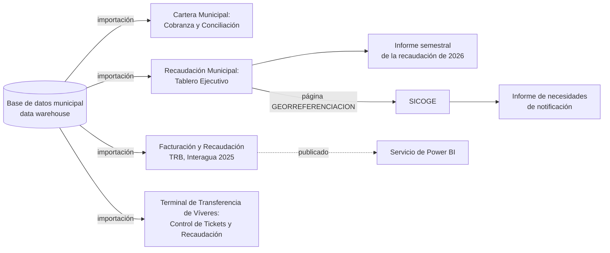
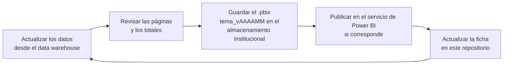

# Dashboards de Power BI: fichas e inventario

Inventario y documentación de los cuatro dashboards de Power BI de la Dirección General Financiera: qué contiene cada uno, de dónde salen sus datos y qué informes se elaboran con ellos.

| | |
|---|---|
| **Autor y responsable** | Jorge Jamil Espinoza Villa, Analista Financiero |
| **Área** | Dirección General Financiera, M.I. Municipalidad de Guayaquil |
| **Plataforma** | Power BI Desktop y servicio de Power BI |
| **Fuente de datos** | Base de datos municipal en un data warehouse |
| **Uso** | Interno. Repositorio privado |

Este repositorio **solo documenta** los dashboards. Los archivos `.pbix` no se suben a GitHub porque pesan entre 183 y 457 MB (el límite de GitHub es 100 MB) y llevan los datos importados dentro. Se guardan en el almacenamiento institucional.

## Contenido

[Mapa general](#mapa-general) · [Inventario](#inventario) · [Estructura de páginas](#estructura-de-páginas) · [Fichas](#fichas) · [Informes](#informes) · [Ciclo de mantenimiento](#ciclo-de-mantenimiento-propuesto) · [Convención de nombres](#convención-de-nombres) · [Estructura](#estructura-del-repositorio) · [Pendientes](#pendiente-por-documentar)

## Mapa general



Cada dashboard importa sus datos al archivo `.pbix`. Solo el de TRB está publicado en el servicio de Power BI.

## Inventario

| Dashboard | Archivo | Tamaño | Último cambio | Páginas | Datos personales |
|---|---|---|---|:-:|---|
| Cartera Municipal: Cobranza y Conciliación | `Cartera Municipal Cobranza y Conciliación.pbix` | 457 MB | oct 2026 | 7 | Sí: RUC, nombre y código predial |
| Recaudación Municipal: Tablero Ejecutivo | `Recaudación Municipal Tablero Ejecutivo.pbix` | 183 MB | oct 2026 | 9 | Por confirmar (parece agregado) |
| Facturación y Recaudación TRB, Interagua 2025 | `Facturación y Recaudación TRB, Interagua 2025.pbix` | 288 MB | feb 2026 | 5 | Por confirmar (nombres de clientes) |
| Terminal de Transferencia de Víveres: Control de Tickets y Recaudación | `Terminal de Transferencia de Víveres Control de Tickets y Recaudación.pbix` | 279 MB | sep 2026 | 5 | No se observa |

## Estructura de páginas

TRB es la Tasa de Recolección de Basura.

```
Cartera Municipal: Cobranza y Conciliación
├── CARTERA                       mapa ArcGIS, tabla, tarjeta y 4 segmentadores
├── CONCILIACIÓN DE CARTERA       tabla y filtro de texto
├── TÍTULOS DE CRÉDITO            2 tablas, 3 segmentadores y tarjeta
├── TÍTULOS DE PREDIOS            tabla, 3 tarjetas y segmentador
├── TÍTULOS DE CEM                tabla, 3 tarjetas y segmentador
├── TÍTULOS DE PREDIOS RÚSTICOS   tabla, 3 tarjetas y segmentador
└── TÍTULOS REGENERACIÓN          tabla, 3 tarjetas y segmentador

Recaudación Municipal: Tablero Ejecutivo
├── DESGLOSE POR CAJERO           tabla dinámica y árbol de descomposición
├── DESGLOSE                      tabla dinámica y visual Inforiver
├── PRINCIPAL                     tabla dinámica y visual Inforiver
├── RUBROS                        visual Inforiver
├── PUNTOS DE RECAUDACIÓN         2 visuales Inforiver
├── NO TRIBUTARIO                 tabla dinámica y visual Inforiver
├── RESOLUCIONES                  visual Inforiver
├── COACTIVA                      árbol de descomposición, tabla dinámica e Inforiver
└── GEORREFERENCIACIÓN            panel HTML y tabla dinámica (ver SICOGE)

Facturación y Recaudación TRB, Interagua 2025
├── Análisis Temporal             gráfico combinado, tabla, tarjeta y 2 segmentadores
├── Perfiles de Pago              tabla, 2 tarjetas y 2 segmentadores
├── Resumen Financiero            2 gráficos combinados, mapa de árbol y tarjeta
├── Facturación vs Recaudación    4 tablas dinámicas y tabla
└── Gestión de Recaudación        2 tablas y 2 segmentadores

Terminal de Transferencia de Víveres: Control de Tickets y Recaudación
├── DASHBOARD                     visual HTML
├── RESUMEN                       barras, línea, 2 tablas dinámicas y 7 segmentadores
├── TICKETS NO PAGADOS            línea, barras, columnas, tabla y 7 segmentadores
├── ANÁLISIS DE TICKETS           tabla, tarjeta, filtro de texto y 3 segmentadores
└── SERIE DE TICKETS              tabla, tarjeta, filtro de texto y 3 segmentadores
```

Los nombres de página son los del archivo `.pbix`, incluidos los errores ortográficos que conviene corregir allí (`DESGLOCE`, `RECAUDADCION`, `TICKTS`).

## Fichas

| Dashboard | Ficha |
|---|---|
| Cartera Municipal: Cobranza y Conciliación | [Ver ficha](fichas/cartera-municipal-cobranza-y-conciliacion.md) |
| Recaudación Municipal: Tablero Ejecutivo | [Ver ficha](fichas/recaudacion-municipal-tablero-ejecutivo.md) |
| Facturación y Recaudación TRB, Interagua 2025 | [Ver ficha](fichas/facturacion-y-recaudacion-trb-interagua-2025.md) |
| Terminal de Transferencia de Víveres: Control de Tickets y Recaudación | [Ver ficha](fichas/terminal-de-transferencia-de-viveres-control-de-tickets-y-recaudacion.md) |


## Informes

Los informes elaborados con estos dashboards están en [`informes/`](informes/): informe semestral de la recaudación de 2026.

## Ciclo de mantenimiento (propuesto)

Proceso sugerido para mantener los dashboards y su documentación al día.



## Estructura del repositorio

```
.
├── README.md
├── fichas/                          una ficha por dashboard: páginas, visuales y pendientes
└── informes/
    ├── README.md
    └── informe-semestral-recaudacion-2026_v202608.pdf
```

## Convención de nombres

`tema_vAAAAMM.pbix` para el archivo guardado en el almacenamiento institucional, con la fecha del último cambio de contenido.

## Pendiente por documentar

- [ ] Tablas o vistas de origen de cada dashboard en el data warehouse y frecuencia de actualización.
- [ ] Responsable y usuarios con acceso.
