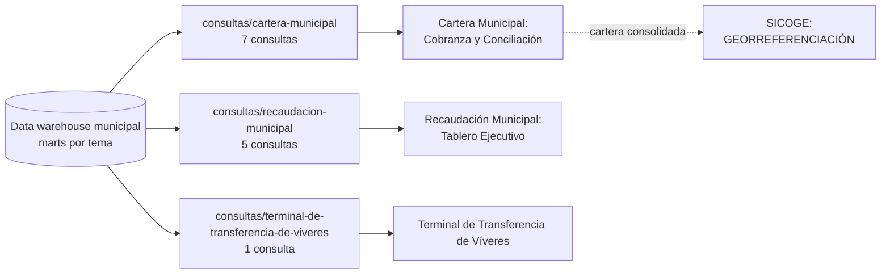

# Consultas SQL de los dashboards

Consultas con las que se cargan los datos de los dashboards de Power BI. Cada una se pega en **Power BI > SQL Server > Opciones avanzadas** (o se ejecuta en SQL Server Management Studio) y trae los datos desde el data warehouse municipal.

Hay 13 consultas aquí. Las 2 que alimentan SIGECO están en el repositorio de SIGECO (carpeta `consultas/`).

## Cómo se conectan

## Consultas por dashboard

### Cartera Municipal: Cobranza y Conciliación

Carpeta: `cartera-municipal/`

| Consulta | Qué responde | Página | Granularidad |
|---|---|---|---|
| [`cartera-consolidada_v202610.sql`](cartera-municipal/cartera-consolidada_v202610.sql) | Cartera consolidada: coactiva en deuda más títulos en deuda sin contraparte coactiva. Segmenta por Pareto (A a E), califica la calidad de la ubicación y trae parroquia y sector. | CARTERA (base de la página GEORREFERENCIACIÓN de SICOGE) | Una fila por obligación |
| [`titulos-sabana-de-trazabilidad-por-juicio_v202610.sql`](cartera-municipal/titulos-sabana-de-trazabilidad-por-juicio_v202610.sql) | Sábana de trazabilidad de títulos de crédito y coactiva. Recupera todos los juicios asociados a cada título y trae controles para no duplicar valores en Power BI. | TÍTULOS DE CRÉDITO | Una fila por título y por juicio coactivo |
| [`titulos-sabana-de-conciliacion_v202610.sql`](cartera-municipal/titulos-sabana-de-conciliacion_v202610.sql) | Versión de la sábana con una sola fila por título (conserva el juicio más reciente), para conciliar sin multiplicar el valor del título ni el valor total al cobro. | CONCILIACIÓN DE CARTERA y TÍTULOS DE CRÉDITO | Una fila por título |
| [`titulos-de-predios-urbanos_v202610.sql`](cartera-municipal/titulos-de-predios-urbanos_v202610.sql) | Cartera de predios urbanos al último corte (31 columnas): antigüedad, estado del juicio, rubros actuales, interés, coactiva, costas y saldo de rubros referencial. | TÍTULOS DE PREDIOS | Una fila por título de predio urbano en el último corte |
| [`titulos-de-cem_v202610.sql`](cartera-municipal/titulos-de-cem_v202610.sql) | Sábana de la cartera de títulos de CEM por predio y año de deuda, en el último corte. Excluye años futuros. Saldo = valor CEM menos valor pagado (mínimo 0). | TÍTULOS DE CEM | Una fila por predio y año de deuda |
| [`titulos-de-predios-rusticos_v202610.sql`](cartera-municipal/titulos-de-predios-rusticos_v202610.sql) | Cartera de predios rústicos en el último corte. El saldo es el total de la planilla para estados D, N y DC; es cero para P (pagada) y X (anulada). Incluye paso de diagnóstico, opción A (sábana) y opción B (esquema estrella) con DAX sugerido. | TÍTULOS DE PREDIOS RÚSTICOS | Una fila por predio y año |
| [`titulos-de-regeneracion_v202610.sql`](cartera-municipal/titulos-de-regeneracion_v202610.sql) | Cartera de regeneración en el último corte: valor total, saldo pendiente y días de mora. Incluye paso de diagnóstico, opción A (sábana) y opción B (esquema estrella) con DAX sugerido. La llave del juicio se llama IdDimJucioCoativo porque así está escrita en la base. | TÍTULOS REGENERACIÓN | Una fila por deuda (IdFactRegeneracion) |

### Recaudación Municipal: Tablero Ejecutivo

Carpeta: `recaudacion-municipal/`

| Consulta | Qué responde | Página | Granularidad |
|---|---|---|---|
| [`recaudacion-coactiva_v202610.sql`](recaudacion-municipal/recaudacion-coactiva_v202610.sql) | Recaudación de la coactiva reconocida por fecha de pago: bruta, ajustes negativos y neta, con sus componentes (deuda, intereses, coactiva, costas, descuentos). | COACTIVA | Mes + Juzgado + Tipo de ingreso |
| [`recaudacion-gerencial-hibrida-2023-2026_v202610.sql`](recaudacion-municipal/recaudacion-gerencial-hibrida-2023-2026_v202610.sql) | Recaudación comparable de 2023 a 2026 hasta el medio de pago. 2023, 2024 y 2026 salen del desglose de cobros; 2025 sale de la fuente de recaudación neta, que no trae canal. | PRINCIPAL y DESGLOSE | Cobro por rubro y medio de pago, sin cajero ni reversos |
| [`recaudacion-por-rubros_v202610.sql`](recaudacion-municipal/recaudacion-por-rubros_v202610.sql) | Recaudación por rubros definidos en un catálogo (incluye rubros sin movimiento, con valores en cero). Trata aparte a un contribuyente especial: se depura por RUC y nombre, se excluye a un homónimo y se descartan las anulaciones. | RUBROS y NO TRIBUTARIO | Rubro y subtransacción |
| [`recaudacion-auditoria-por-cajero_v202610.sql`](recaudacion-municipal/recaudacion-auditoria-por-cajero_v202610.sql) | Detalle de auditoría por cajero desde el 1 de enero de 2026: llaves de auditoría, usuario técnico, nombre visible y marca de posible duplicado entre SPI y transferencia, para cuadrar asignaciones. | DESGLOSE POR CAJERO | Cobro por medio de pago y cajero |
| [`recaudacion-por-puntos-de-recaudacion_v202610.sql`](recaudacion-municipal/recaudacion-por-puntos-de-recaudacion_v202610.sql) | Recaudación por fecha, cajero o recaudador y punto físico de recaudación, de 2023 a 2026. Conserva el punto «NO DEFINIDA» tal como viene en la fuente. | PUNTOS DE RECAUDACIÓN | Fecha + recaudador + ubicación + origen |

### Terminal de Transferencia de Víveres: Control de Tickets y Recaudación

Carpeta: `terminal-de-transferencia-de-viveres/`

| Consulta | Qué responde | Página | Granularidad |
|---|---|---|---|
| [`ttv-eventos-de-caja-tickets-sin-pago-y-abonados_v202610.sql`](terminal-de-transferencia-de-viveres/ttv-eventos-de-caja-tickets-sin-pago-y-abonados_v202610.sql) | Consulta integral del terminal para 2026: eventos de caja (pago normal, repago y pago manual), tickets sin pago y movimientos de abonados y tarjetas, con indicadores de alerta. | DASHBOARD, RESUMEN y TICKETS NO PAGADOS | Un registro por evento de caja, ticket sin pago o movimiento de abonado |

## Convenciones

- Nombre del archivo: `tema_vAAAAMM.sql`, en minúsculas y con guiones.
- Cada archivo empieza con un bloque de encabezado: qué responde, dashboard y página, bases de origen, granularidad, autor y versión.
- Las bases de origen son *marts* del data warehouse (por ejemplo `RECAUDACION_DM`, `COACTIVA_DM`, `TITULOS_CREDITO_DM`).
- Los archivos de **predios rústicos** y de **regeneración** traen un paso de diagnóstico, la opción A (sábana completa), la opción B (esquema estrella) y medidas DAX sugeridas dentro de comentarios.
- Varias consultas toman por defecto el **último corte** disponible. Las de recaudación usan fechas fijas de inicio (2023 o 2026) y cierran en la fecha de hoy.

## Marcadores en las consultas

Estas versiones están **sanitizadas**. Antes de ejecutarlas hay que completar los marcadores:

| Marcador | Dónde | Qué poner |
|---|---|---|
| `<servidor>` | `titulos-de-cem`, `titulos-de-predios-rusticos`, `titulos-de-regeneracion` | Nombre del servidor del data warehouse |
| `<RUC_OTECEL>` | `recaudacion-por-rubros` | RUC del contribuyente especial que se depura aparte |
| `<NOMBRE COMPLETO>`, `<USUARIO>` | `recaudacion-auditoria-por-cajero` | Solo aparecían en un comentario. No hay que completarlos |
| `<total>` | `cartera-consolidada` | Solo aparecían en un comentario con los totales esperados. No hay que completarlos |

## Seguridad

- Las consultas solo contienen lógica. **No hay datos de contribuyentes**, contraseñas ni cadenas de conexión.
- Varias consultas **devuelven** datos personales al ejecutarse (identificación, nombre, correo, teléfono, placa). El resultado vive en el `.pbix` y no se sube a GitHub.
- Los valores reales (servidor, RUC, nombres) se guardan en el almacenamiento institucional, fuera del repositorio.
